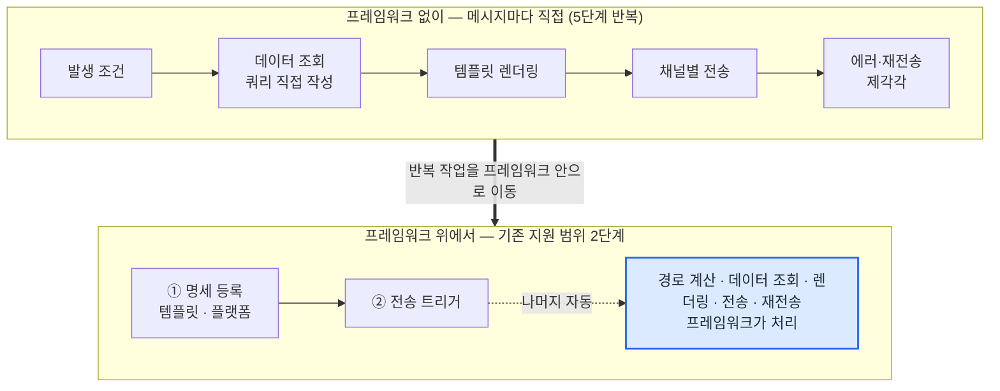
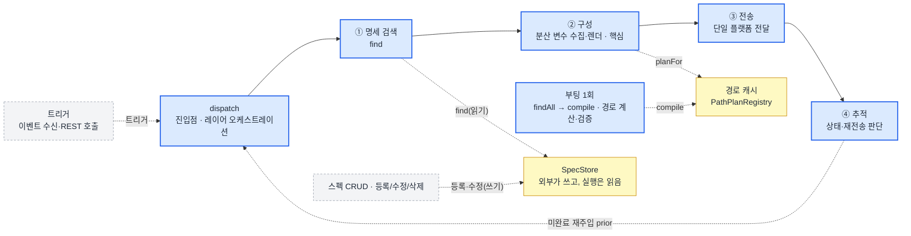
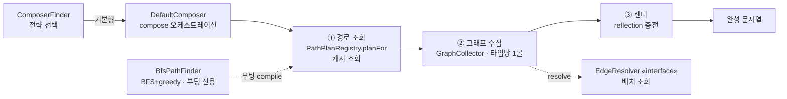
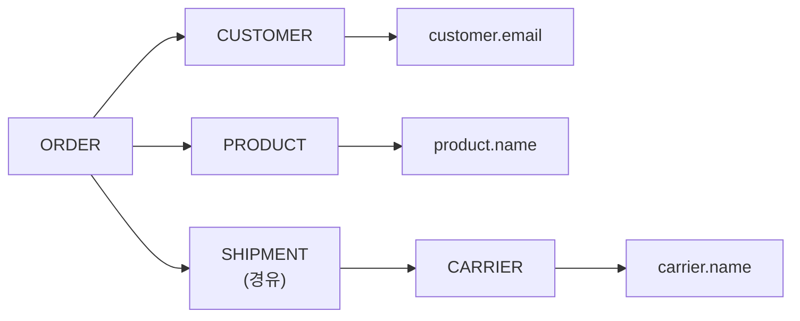

# 명세 기반 메시지 발송 프레임워크

> **재구성본 안내.** 이 저장소는 회사 코드가 아닙니다. 전 직장에서 발의하고 단독 설계·구현한(2023.04 ~ 2023.07 구축, 2024.06까지 확장) 메시지 발송 프레임워크의 설계를, 퇴사 뒤 회사 코드·데이터 없이 처음부터 다시 구현했습니다. 회사·고객사 이름과 실제 업무 데이터·API는 넣지 않았고, 예시 도메인은 일반적인 주문(주문·고객·상품·배송)으로 바꿨습니다. 구현과 테스트 작성에는 AI 코딩 에이전트를 썼습니다. 본문의 "운영"은 재직 중 실제로 운영한 내용, "공개 재구성"은 이 저장소에만 있는 내용이며, 둘의 경계는 끝의 [`공개 코드와 증명 범위`](#공개-코드와-증명-범위)에 표로 정리했습니다.

> 3개 프로덕트와 3개 팀에서 식별자 이벤트를 실제 메시지로 완성할 때마다 여러 서비스의 데이터를 조회·조합하고 전송·실패 처리를 반복해야 했습니다.
>
> 제품 서비스의 도메인 이벤트를 구독해 명세대로 메시지를 조립·발송하는 공통 서비스를 발의하고 단독 설계·구현했습니다. 템플릿 변수의 데이터 출처는 서비스 간 도메인 관계 그래프에서 BFS로 경로를 찾고 Resolver가 각 서비스 API로 조회합니다. 스택·배포 주기가 다른 여러 마이크로서비스가 함께 쓰도록 라이브러리가 아닌 독립 서비스로 두었습니다.
>
> 기존 그래프·채널·기본 Composer 범위에서는 신규 메시지 추가 절차가 5단계에서 `명세 등록 → 전송 트리거 연결`의 2단계로 줄었으며, 새 Resolver·채널·특수 Composer에는 코드 변경과 배포가 필요했습니다. 이메일·Slack·알림톡 메시지 추가는 이 명세 등록 방식으로 신규 메시지 개발의 팀 표준이 됐습니다.

## 신규 메시지 추가 절차의 변화

기존 지원 범위에서는 메시지마다 다시 구현하던 다섯 작업 중 데이터 조회·렌더링·채널 전송·실패 처리를 프레임워크가 맡고, 새 메시지의 변경 지점은 두 곳으로 줄었습니다.

이 결과는 새 요구사항이 기존 도메인 그래프·채널·기본 Composer로 표현될 때의 변화입니다. 새 도메인 관계, 채널 또는 특수 조합이 필요하면 해당 확장점의 코드와 배포가 추가됩니다.

## 반복 비용이 생긴 이유

**메시지 개발 비용이 선형으로 계속 늘어나는 구조**

* **분산된 변경 지점** — 각 팀과 서비스가 발생 조건·템플릿·채널·실패 처리를 별도로 구현해, 비슷한 메시지도 기존 코드를 역추적해야 했습니다.
* **가장 큰 반복 비용** — 주문·고객·상품·배송처럼 여러 도메인의 변수가 필요할 때마다 서비스별 조회 순서와 조합 코드를 새로 작성했습니다.
* **설계 목표** — 명세·구성·전송·추적을 공통 실행 흐름으로 만들되, 메시지별 특수 처리와 신규 도메인 연결은 명시적인 확장점으로 남겼습니다.

## 핵심 설계: 분산 데이터 조합과 메시지 라이프사이클

**설계의 두 축:**

* **레이어 분리** — 메시지 처리를 명세 → 구성 → 전송 → 추적 네 레이어로 분리. 레이어마다 책임을 응집하고, 기본 동작에 override를 열어 특수 케이스를 흡수.
* **분산 변수 수집** — 메시지마다 손으로 짜던 조회 쿼리를, 공통 그래프와 경로 계산이 만드는 자동 쿼리로 대체.

### 메시지 라이프사이클

진입점 `dispatch`가 네 레이어를 순서대로 오케스트레이션:

* **명세** — 메시지 정의를 한 객체로 읽음
* **구성** — 분산 변수를 수집해 본문 완성 (핵심)
* **전송** — 명세가 지정한 채널로 전달
* **추적** — 결과로 상태 전이·재전송 판단

**다이어그램 = `dispatch`가 ①~④를 관통하는 실행 흐름.**

### 명세

"주문 완료" 메일 한 건의 여정은 명세에서 시작.

* **역할** — 메시지 한 건의 정의를 `MessageSpec` 한 객체에 담음. 이후 모든 레이어가 이 객체만 읽고 동작.
* **단일 명세 근거**
  * **정의 소재지 일원화** — 한 메시지의 정의가 흩어지지 않고 한 객체에 모이므로, 찾고 고칠 곳이 하나로 고정.
  * **데이터 주도 소비** — 기존 그래프·채널·기본 Composer 범위에서는 새 메시지가 명세 값으로 추가되므로, 레이어는 메시지별 분기 없이 값만 읽음.
* **MessageSpec이 담는 것** — 각 레이어가 자기 필드만 읽음:
  * `template` — 무엇으로 만들지 → **구성**이 읽어 변수 채움
  * `platform` — 어디로 보낼지 → **전송**이 읽어 채널 선택
  * `retryBudget`·`repeatBudget`·`interval` — 몇 번·어떤 간격으로 다시 보낼지 → **추적**이 읽어 재전송 판단
* **특징**
  * **선언이 곧 명세** — 템플릿의 토큰 `{{CUSTOMER.email}}` 하나가 "이 변수를 채워라"는 지시. 명세를 적는 순간 수집할 데이터가 정해지고, **구성** 레이어가 이 토큰을 해석해 수집을 실행.

### 구성 (핵심)

'무엇을 보낼지'는 명세가 정했고, 이제 템플릿의 `{{CUSTOMER.email}}` 같은 변수를 실제 값으로 채울 차례. 이 일을 맡는 구성이 프레임워크의 핵심 레이어.

* **역할** — 명세의 템플릿 변수를 실제 값으로 채워 최종 메시지 문자열을 완성. **반복 개발 비용을 가장 크게 줄이는 핵심 레이어.**
* **그래프 채택 근거**
  * **반복 수집 코드 통합** — 기존 관계 그래프가 포괄하는 데이터는 메시지마다 조회 순서를 다시 작성하지 않고 명세의 변수 선언으로 수집.
  * **경로 탐색 비용 제거 — 공개 재구성** — 부팅 때 경로를 계산하므로 매 전송의 BFS는 사라지지만, Resolver의 데이터 조회·외부 호출 비용은 그대로 남음.
  * **확장 경계 명시** — 기존 그래프·채널·기본 Composer 범위는 명세 중심으로 추가하고, 새 도메인·채널·특수 조합은 구현체 추가와 배포로 확장.
* **특징**
  * **그래프 모델링·경로 계산** — 도메인 간 관계를 공통 그래프 한 벌로 모델링하고, 필요한 변수에서 거꾸로 따라가 수집 경로를 계산.
  * **부팅 선계산 — 공개 재구성에서 추가한 개선** — 운영 구현은 전송 시 BFS를 수행했고, 공개 코드는 경로 계산을 부팅 시 1회 수행해 캐시하도록 재구성.
  * **확장점** — 특수 메시지는 Composer 전략, 새 도메인은 간선(`EdgeResolver`), 새 채널은 `Channel` 구현이 필요함.

**클래스 · 흐름** — `ComposerFinder`가 전략을 고른 뒤, `DefaultComposer`가 ① 경로 조회 → ② 그래프 수집 → ③ 렌더 순으로 변수를 채움:

**심화 — 부팅 경로 계산.** "주문 완료" 메일의 변수 세 개에서 도메인을 거꾸로 따라가 경로를 확정:

> 변수 `customer.email · product.name · carrier.name` → 필요한 도메인 `{CUSTOMER, PRODUCT, CARRIER}` (SHIPMENT은 CARRIER로 가는 경유지).

공개 재구성의 부팅 compile은 경로를 확정하며 다음 두 종류를 검사:

* **도달성** — 변수에 필요한 도메인까지 그래프로 닿는가
* **속성 존재** — 그 도메인에 실제로 그 속성이 있는가(reflection)

공개 재구성은 도달성과 속성 존재를 부팅 시 검증하되, 개별 명세 오류와 전체 초기화 실패를 구분합니다. 검증 API별 정확한 경계는 후반의 `공개 코드와 증명 범위`에 정리했습니다.

### 전송

구성이 본문을 완성했으니, 이제 "주문 완료" 메일을 실제로 내보낼 차례.

* **역할** — 완성된 메시지를 **명세가 지정한 채널**(`platform` 값. 운영에서는 이메일·Slack·알림톡)로 전송.
* **얇은 위임 근거**
  * **오류 의미 분리** — 설정 오류와 일시적 전달 실패를 갈라, 재시도해도 소용없는 오류에 재시도를 낭비하지 않음.
  * **책임 경계** — 재전송 판단은 추적이, 실제 전달은 채널이 맡으므로, 전송이 정책·상태를 떠안지 않음.
  * **교체 용이** — 새 채널 도입·교체가 다른 레이어를 건드리지 않고 한 지점에서 완결.
* **특징**
  * **오류 신호 분리** — 등록 안 된 채널이면 즉시 예외를 던지고, 네트워크 같은 일시적 실패만 `false`로 돌려 **추적**이 재전송을 판단.
  * **전송은 직접, SDK만 분리** — 채널 선택·`send` 호출·성공/실패 판정은 프레임워크 코드가 직접 하고, 외부 채널 SDK(Slack·Email·푸시)만 `Channel` 인터페이스 뒤로 격리.
  * **무상태 디스패치** — `platform`으로 채널을 찾아 보내고, 결과(`true`/`false`)만 **추적**에 전달.
  * **교체점** — 새 채널은 `Channel` 구현체 하나 추가.

### 추적·재전송

전송이 실패한 메일을 언제 다시 보내고 언제 포기할지, 그 판단이 추적의 몫.

* **역할** — 전송 결과를 받아 한 건의 처리 상태를 전이하고 **재전송할지 끝낼지** 판단. 재전송이 무한 반복되지 않게 막는 책임선.
* **결함 격리 근거**
  * **장애 전파 차단(가용성)** — 재전송은 모든 due 건을 함께 굴리는 공유 엔진 위에서 돌아, 한 건의 영구 실패가 엔진을 멈추면 뒤의 재전송이 전부 정지. 이 연쇄를 끊어 가용성을 보존.
* **특징**
  * **재전송 스케줄링(due-time scheduling)** — 다음 due 시각을 계산해 대기열에 저장하고, 주기 폴링(`RetransmissionScheduler`)이 due 건을 재주입.
  * **결함 격리 메커니즘** — `supervisorScope`로 각 건을 독립 실행해 실패를 개별 scope에 격리. 실패 건은 버리지 않고 매 폴링마다 `onError`로 재노출.
  * **조정점** — 재전송 동작(횟수·간격)은 코드 교체가 아니라 명세 값으로 조정.

`MessageDispatch`는 성공 여부와 남은 예산을 기준으로 상태를 정하고, 비종료 건만 다음 due 시각과 함께 `MessageStore`에 남깁니다.

| 결과와 예산 | 다음 상태 | 대기열 |
|---|---|---|
| 성공·반복 예산 남음 | `REPEATING` | 다음 `dueAt`에 재주입 |
| 실패·재시도 예산 남음 | `RETRYING` | 다음 `dueAt`에 재주입 |
| 성공·반복 예산 소진 | `COMPLETED` | 이탈 |
| 실패·재시도 예산 소진 | `EXCEEDED` | 이탈 |

`RetransmissionScheduler`와 `RetransmissionDriver`는 due 건을 `prior`와 함께 다시 주입하며, 각 건의 실패는 `supervisorScope`로 격리합니다.

## 선택과 대가

* **경로 탐색은 비가중 BFS에 그리디 조합까지만.** 도메인 그래프가 얕고 간선 비용이 균질해 이 수준이면 충분하다고 판단. 도달 정확성은 BFS가 보장하고, 다도메인 묶음의 경로 개수 최소화는 보장하지 않는다. 운영 구현은 실행 시 탐색했고, 공개 재구성은 이를 부팅 시 선계산한다.
* **변수 수집은 리플렉션 기반을 유지.** 기존 schema 안에서 새 변수를 명세로 추가하는 유연성을 컴파일타임 안전성보다 앞에 둠. 오타를 컴파일러가 잡지 못하므로 공개 재구성은 `compileOne`과 부팅 `compile`에서 도달성·속성 존재를 검증한다. 개별 명세 제외와 전체 초기화 실패의 경계는 위 정책을 따른다.
* **분산돼 있던 메시징을 단일 프레임워크로 통합.** 규칙과 확장점이 한곳에 모여 일관되는 대가로, 코어 결함이 전 메시지로 번질 수 있는 단일 장애점을 안게 됨. 구조로 제거할 수 없는 비용이라, 격리·점진 배포 같은 운영 수단으로 영향 반경을 좁히는 것을 전제로 한 선택.
* **전송과 상태 기록은 외부 효과 기준 exactly-once가 아님.** 채널 전송 성공 후 상태 저장 전에 프로세스가 종료되면 재시도에서 중복 전송될 수 있다. 공개 코드는 이 crash window를 제거하는 영속 adapter나 채널별 멱등 키를 포함하지 않는다.

## 공개 코드와 증명 범위

| 구분 | 이 README에서 다루는 범위 |
|-|-|
| 실제 운영 경험 | 도메인 이벤트를 구독하는 독립 마이크로서비스, 실행 시 BFS와 Resolver 18종(서비스 API 조회)을 통한 분산 데이터 수집, 조회 조건이 특수한 메시지의 별도 조립 구현, 예약·반복 발송과 전송 중 멈춘 건의 복구 스케줄러(중복 발송 가능성 허용), 이메일·Slack·알림톡 메시지의 명세 등록, 기존 지원 범위의 추가 절차 5단계→2단계 |
| 공개 재구성 코드 | 부팅 시 경로 precompile·cache, 타입별 batch 수집, bounded concurrency, 명세별 격리와 초기화 실패 경계 |
| 공개 범위 밖 | 실제 등록 API·영속 Store adapter·Slack/Email/Push SDK 연동 |

공개 코드의 명세 검증 API는 다음 경계를 갖습니다.

* `compileOne` — 명세 한 건의 오류를 즉시 반환하지만, 공개 코드에는 이를 호출하는 등록 API가 없습니다.
* `compile` — 부팅 시 잘못된 개별 명세는 제외하고 정상 명세를 계속 사용하며, 모든 명세가 제외되거나 Resolver·schema wiring이 잘못된 경우 초기화를 실패시킵니다.
* `planFor` — 초기화 전, 제외된 명세, 컴파일되지 않은 명세를 구분해 보고합니다.

| 확인할 질문 | 대표 코드 | 대표 테스트 |
|---|---|---|
| 경로를 어떻게 찾는가 | [`BfsPathFinder.kt`](src/main/kotlin/dev/portfolio/notification/graph/core/BfsPathFinder.kt) | [`BfsPathFinderTest.kt`](src/test/kotlin/dev/portfolio/notification/graph/BfsPathFinderTest.kt) |
| 부팅 검증과 경로 cache 경계는 무엇인가 | [`PathPlanRegistry.kt`](src/main/kotlin/dev/portfolio/notification/compose/PathPlanRegistry.kt) | [`BootPrecompileTest.kt`](src/test/kotlin/dev/portfolio/notification/compose/BootPrecompileTest.kt) |
| 여러 도메인의 데이터를 어떻게 수집하는가 | [`GraphCollector.kt`](src/main/kotlin/dev/portfolio/notification/compose/GraphCollector.kt) | [`GraphCollectorTest.kt`](src/test/kotlin/dev/portfolio/notification/compose/GraphCollectorTest.kt) |
| 구성·전송·상태 저장을 어디서 연결하는가 | [`NotificationPipeline.kt`](src/main/kotlin/dev/portfolio/notification/pipeline/NotificationPipeline.kt) | [`NotificationPipelineTest.kt`](src/test/kotlin/dev/portfolio/notification/pipeline/NotificationPipelineTest.kt) |
| due 재전송의 오류를 어떻게 격리하는가 | [`RetransmissionDriver.kt`](src/main/kotlin/dev/portfolio/notification/pipeline/RetransmissionDriver.kt) | [`RetransmissionDriverTest.kt`](src/test/kotlin/dev/portfolio/notification/pipeline/RetransmissionDriverTest.kt) |

순수 Kotlin 단일 모듈 — 명세·구성·전송·재전송 로직과 단위 테스트를 포함합니다.

* **환경**: Kotlin 1.9.24 · JVM 타깃 17 (Gradle 8.5 / JDK 21) · 의존성: kotlin-reflect · kotlinx-coroutines · kotlinx-datetime · kotest.

